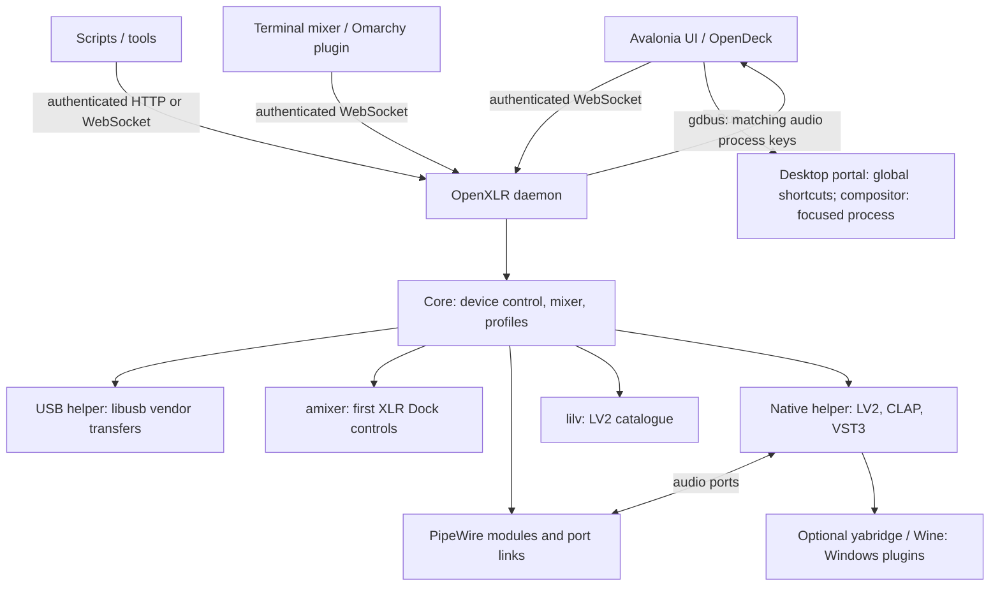

# Architecture



- `OpenXLR.Daemon` owns the device and graph. It polls hardware, maintains
  the mixer, routes application streams and broadcasts state to clients.
  The process reads the system default sink and source at the top of
  `Main`, before any hosted service, since connecting the device switches
  the card's profile and WirePlumber then moves the defaults to the new
  nodes; the hosted services start in the order watchdog, device manager,
  mixer service, additional interfaces; under Flatpak a parent-process
  wait takes the watchdog's place. The content root is the install directory, whatever the
  working directory. The WebSocket endpoints and HTTP API share one
  dispatcher over the private Unix socket. The transport verifies Linux
  peer credentials before it reads HTTP; browser Origins, command sizes
  and rates are checked as well.
- `OpenXLR.UI` is an Avalonia client with no Core assembly dependency. It
  parses state and sends commands. It also manages local UI preferences,
  autostart and the daemon service, collects diagnostics, and optionally
  checks GitHub releases. Closing it leaves audio running. Its Flow window
  builds a four-column view from state; selecting a path changes only
  the visualization. The UI also owns the desktop keys: it registers
  shortcuts through the `org.freedesktop.portal.GlobalShortcuts` portal on
  a private session-bus connection and turns a press into a daemon
  command, while hidden in the tray as well. For focused-application
  routing it serves `org.openxlr.Desktop` on that bus. KWin's read-only
  script, Sway's tree, Hyprland's or Niri's active window, X11's EWMH
  properties or the optional GNOME Shell extension supply the process id
  on demand. X11 supports native clients only. The daemon sends its live
  audio process keys to the UI through `gdbus`, one request at a time. The UI
  resolves Flatpak instance ids to host PIDs and returns matching keys only;
  the daemon rechecks their current audio identity before routing.
  The GNOME extension authorizes only the bus owner of `org.openxlr.Desktop`.
  The UI uses that same connection, retaining at most one unanswered GNOME
  query so a stalled shell cannot accumulate replies or close desktop keys.
- The OpenDeck plugin is an OpenAction plugin in OpenDeck's Node runtime,
  using the same authenticated API and live choices as the UI.
- `OpenXLR.Tui` is the terminal mixer, `openxlr-tui`. It speaks the same
  authenticated WebSocket, draws its own cells, and reads the UI's
  skins from the same folders and the same saved choice. Like the UI
  it has no reference to Core, and it has no NuGet dependency.
- The Omarchy plugin, `packaging/omarchy/openxlr.mixer/`, is QML for
  Omarchy 4's bar. Like OpenDeck it uses the client-only `openxlr-control`
  adapter for the Unix WebSocket and the documented commands;
  [omarchy.md](omarchy.md) has its limits.
- `OpenXLR.Core` contains device backends, the PipeWire adapter, mixer,
  application matching, plugin catalogues and profile storage. The native
  host processes plugin audio without passing samples through managed code.

Configuration lives in `$XDG_CONFIG_HOME/openxlr` (default `~/.config/openxlr`).
The control socket and instance lock live in `$XDG_RUNTIME_DIR/openxlr`, falling back
to the configuration directory when unavailable. See [api.md](api.md) for
file names and [http-api.md](http-api.md) for transport limits.

## The PipeWire graph

Everything is built with standard PipeWire modules and tools, no kernel
modules or custom drivers:

- One null sink per mix (`pactl load-module module-null-sink`): the
  two monitor mixes, one per virtual microphone, and Aux.
- One combine sink per channel (`module-combine-sink`) whose internal
  streams, one per mix, are the send faders: setting a send is setting
  that stream's volume. Applications play into these sinks. The combine
  names its targets by pattern (`slaves=~OpenXLR_mix_`), and PipeWire's
  combine keeps watching the registry, so a mix sink created later gets
  its own stream in every combine and a removed one loses them without
  any channel being reloaded. The default layout's 9 channels and 5
  mixes are 14 sinks and no loopback processes.
- Core's internal ducking plan can send selected cells through a hidden
  null sink per mix, `OpenXLR_mix_<id>.duck`, and a native stereo stage,
  `OpenXLR_duck_<id>`. The bus matches the combine pattern and grows a leg
  in every channel without reloading it. A target cell's direct leg is
  held at zero and muted; its bus leg carries the usual send level,
  channel volume and mute. Every other bus leg is zero and muted. The
  stage feeds the mix's playback ports, where PipeWire sums it with the
  direct sends. Monitor masters, mix inserts, latency delays, consumers
  and mix meters still read the same mix. The stage has no algorithmic
  latency. Each bus reserves headroom for one stream per channel and
  two nodes before it is created.
- The duck key is the key channel's `monitor_FL`, after input EQ, inserts
  and Sound Check, before channel volume and sends. The key's own cells
  cannot be targets. `key_open` follows whether any key send is audible
  after channel volume, send mutes, exclusive groups, mix controls and
  hardware-path silencing. Controls go live over the helper's command
  pipe. Turning the plan off lets the gain recover at its release rate
  and keeps existing stages until a rebuild. An off plan starts none.
- A duck bus's output stays disconnected until all its legs have their
  intended levels. A move onto the bus closes the direct leg first; a
  move back disconnects the output first. Channel creation and reload
  disconnect bus outputs while their new legs are set. The healing sweep
  repairs duck links and replaces failed stages under the insert restart
  policy, keyed `duck:<mix>`. A failed stage gets a bus-monitor bypass on
  that sweep and is retried on a later one; repeated failures leave the
  bypass carrying audio. `ReadMeters` adds `duck:<mix>` with one reduction
  value in dB for each mix fed by a running stage. The daemon drives the
  plan from the saved ducking setup: buses and stages exist only while
  ducking runs in software with at least one ducked cell, so a start with
  ducking off, or taken over by the Wave XLR Pro, creates none. Placement
  and the hand-over to the unit are in [api.md](api.md#where-ducking-runs);
  the daemon reaches the unit through `DeviceDuckingPort`, which posts the
  presets and USB pairs the unit should hold to the device manager and
  reads back a cached status without USB transfers, as the EQ's port does.
- For every virtual-microphone mix, a post sink fed from the mix
  (directly or through the mix's insert chain) and a remap source
  (`module-remap-source`) reading its monitor: the virtual microphone an
  application records from. The indirection means adding inserts later
  never recreates the device the application is recording.
- The layout is edited live (`docs/mixer-layout.md`): a channel or mix
  is added by loading its own nodes, removed by unloading them, and a
  channel is renamed by reloading its sink and moving its streams back.
  A virtual microphone is never reloaded for a rename, since a recorder
  does not come back to a reloaded device; its description follows at
  the next daemon start. Every edit is written to `mixer.json` before it
  is acknowledged.
- pipewire-pulse hosts all of these modules and inherits systemd's
  default limit of 1024 open files; every combine stream and meter costs
  it a few. The daemon refuses an addition without headroom and the
  packages install a drop-in raising the limit. When pipewire-pulse
  restarts it takes every module with it and reuses their ids, so the
  daemon forgets the graph without unloading anything and exits with
  code 75 for systemd to start it afresh.
- Filter chains (the software low cut and ClipGuard, and LV2
  inserts left on the default backend) are `filter-chain` nodes, each held by a
  long-lived `pw-cli -m` process for the life of the chain; their
  controls are set with `pw-cli set-param`.
- A native insert runs in an `openxlr-lv2-host` process with a PipeWire
  filter node. LV2 chooses this per insert; CLAP and VST3 always use it.
  Stages can mix native and filter-chain backends, linked in signal order.
  The command pipe carries parameter values, status, the plugin's reported
  latency and editor requests, never audio. Exposed parameters are persisted; opaque plugin state and
  presets are not. See [native/README.md](../native/README.md) for editor
  recovery, size constraints and LSP renderer defaults.
- With latency compensation on, a mix that needs a delay gets a stereo
  filter-chain of two builtin delay lines (`OpenXLR_delay_<mix>_in` and
  `_out`) after its inserts, and its consumers read that. The delay is set
  with `pw-cli set-param`, so a changed figure moves it without touching the
  plugins. See [plugin latency](api.md#plugin-latency).
- Direct port links (`pw-link`) wire hardware inputs, chains, mixes and
  outputs, so the output device clocks the chain. Hardware inputs are
  wired by capture-channel pair (XLR 1 = pair 0, XLR 2 = pair 1, Line
  In/USB Aux = pair 2); the Aux mix feeds the device's aux return pair
  so the hardware forwards it to the USB Aux port.
- Each mix in an output's feed is a direct port link from the mix's
  monitor into that output, and PipeWire sums what arrives on one port,
  so a feed of several mixes costs no node. Outputs on one hardware bus
  share one route identity. A
  capture channel is linked from its source node by pair offset, both
  sides of a mono source, and only a complete link counts as healthy.
- The daemon follows the graph through one `pw-dump --monitor`
  subscription, held in an incremental snapshot keyed by object id and
  bounded at 8 MiB. A disconnect discards every object before an id can
  be reused and reconnects with a delay growing from 250 ms to 5 s;
  while it reconnects, a one-shot `pw-dump` cached for 400 ms serves the
  sweep, and standalone tools use that path alone. `wpctl` sets card
  profiles (parking the Pro on pro-audio) and
  send-leg volumes; `pactl` sets sink, source and application-stream
  volumes and mutes; `pw-cli set-param` sets filter-chain controls; and
  `parec` on the sinks' monitors feeds the level meters. Helpers run in the C locale, since `pactl`'s output is parsed
  and localised.
- Sink and source properties reach `pactl` as one double-quoted list
  with descriptions single-quoted inside (PipeWire's module parser
  splits the argument on whitespace, then parses the list). Application
  channels and the virtual microphones carry `node.virtual=false` so
  desktop applets list them; hardware input channels keep the flag and
  stay hidden.

## Plugin discovery and Windows bridging

LV2 metadata is read through lilv. CLAP and VST3 bundles are described in
isolated helper processes, with bounded output and a cache invalidated by
bundle changes. An optional managed bridge also keys that cache by its
package version, source commit and installation directory.

`ManagedYabridge` selects a complete companion installation, or falls back
to the system/user bridge. It prepends the companion to PATH only for the
scanner, host and controller it starts. Plugin processes retain HOME,
WINEPREFIX and their settings environment. The scanner, host, controller
and Wine uninstaller get `wineusb.sys=d` appended to `WINEDLLOVERRIDES`,
unless the inherited value already names that driver, so a prefix they
start does not open every USB device. The controller alone receives
a private configuration root and wrapper destination. Private wrappers
are searched first and deduplicated by plugin id.

The companion supplies 64-bit yabridge; Wine remains external. Its pinned
source, package formats and separate artifact workflow are documented in
[packaging/yabridge](../packaging/yabridge/README.md).

## Application identity

Playback-node metadata takes precedence, with missing application and
process fields filled from the owning PipeWire client. Electron process
names and Wine/Proton executable names are normalized before looking up
routing rules and saved overrides. On loading legacy aliases, an existing
canonical override wins. Assigning or forgetting an app uses the same key.
Pre-assignments from desktop launchers remain best-effort when the running
application reports a different identity. A focused-application request
carries a process id, resolved against the daemon's live audio clients,
directly or through a client's parent chain, and never guessed from a
window title; an id that matches no client, or several identities, is
refused.

## The device protocols

The seven devices use vendor-block and class-request protocols plus ALSA
controls, all reached without detaching the kernel's audio driver:

- Wave XLR Pro, Wave XLR MK.2 and XLR Dock MK.2: a vendor block bank
  on the unclaimed interface (`bmRequestType 0x41/0xC1`, `bRequest 1`,
  `wIndex 0x0103` on the Pro, `0x0203` on the Wave XLR MK.2, and on the
  XLR Dock MK.2 whichever of the two its firmware answers, probed at
  connect). Fixed-size
  blocks hold gain, packed flag bits, and on the Pro the hardware mix
  matrix; a write reads the block, modifies it, writes it back, and on
  the Pro follows with a commit block. Offsets and how they were found:
  [wave-xlr-pro-protocol.md](wave-xlr-pro-protocol.md)
- Wave XLR (MK.1) and XLR Dock: a class-request protocol
  (`bRequest 0x85/0x05`, `wIndex 0x3303`) with one config block, as
  documented by the openwave project. The dock answers it too, which is
  how it gained phantom power (config byte 6) and low impedance (byte
  33); its everyday controls (gain, mute, headphone volume) go through
  the kernel's standard ALSA controls with `amixer` when the kernel
  created them, and through the block (gain word at 0, mute byte 4,
  headphone word at 9) when it did not: a unit whose firmware answers the
  capture volume's range query badly loses that ALSA control. Each
  control takes one path only, since the kernel caches feature-unit
  values. Its DSP is provided host-side by the submixer

libusb runs outside the daemon (`OPENXLR_USB_INPROCESS=1` keeps it
inside, for debugging): a helper process (the daemon
binary started with `--usb-helper`) owns it and answers open, close and
control-transfer requests over length-prefixed frames on its stdin and
stdout. The helper claims the vendor interface when it opens the device
and releases it on close; a claim that fails counts as the device not
opened. Every transfer runs under a watchdog (the libusb timeout plus
3 s); one that never returns is reported, the helper is killed so the
operating system reclaims the stuck thread and the device handle, the
device is dropped and reconnected through a fresh helper, and the
daemon keeps serving. After three hangs of one device without a replug
the daemon sets it aside instead of retrying. A helper whose device
could not be opened at all (no permission yet, a busy interface) is
killed at once, and the next attempt waits two seconds, so a device the
udev rule has not reached yet never turns into a stream of helper
processes. A device that opens but answers a poll badly is dropped and
reopened after 2 s, doubling on each further failure up to 32 s.

## Repository layout

```
src/            .NET solution: Core (device + mixer), Daemon, UI, Tui, Probe, Tests
native/         optional C/C++ plugin host, vendored interface headers, noise removal
                (RNNoise under rnnoise/, DeepFilterNet's Rust wrapper under deepfilter/), tests
plugin/         the OpenDeck (Stream Deck) plugin
docs/           this documentation, protocol write-up, capture guides
tools/          proprobe.py, a standalone Python probe for the vendor protocol,
                and the CI checks (versions, locked restores, the OpenAPI
                document's shape, the rpm recipe's %files)
packaging/      systemd unit, the pipewire-pulse open-file drop-in, udev rule,
                WirePlumber rules, UCM profile, rpm and nix packaging, OpenDeck patches,
                the Omarchy bar plugin and its enable command,
                optional yabridge companion source and package recipes
debian/         Debian/Ubuntu packaging
```
